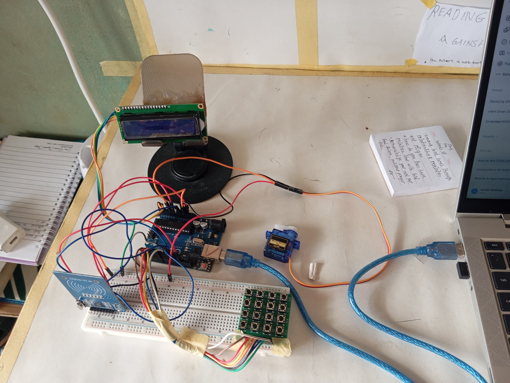
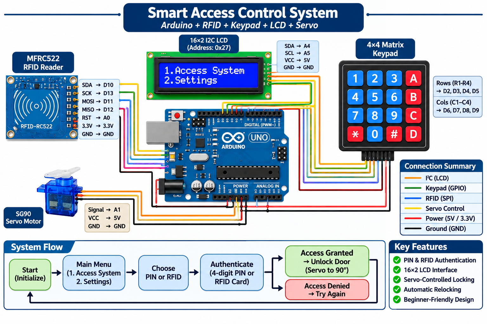

# smart-access-control-system.

An Arduino-based access control prototype that uses **two alternative authentication methods: a 4×4 keypad for PIN entry and an RFID reader for card authentication**. A 16×2 LCD provides system feedback, while a servo motor simulates the locking and unlocking mechanism.

## Project Overview

The Smart Access Control System demonstrates how embedded systems can be used to build a basic electronic access control solution.

Users can authenticate using either:
- A predefined four-digit PIN.
- An authorised RFID card.

When authentication is successful, the system grants access and activates the servo motor. If authentication fails, access is denied.

## Project Images

### Physical Prototype

### Wiring Diagram

## Features

- Dual authentication options: PIN or RFID.
- 4×4 matrix keypad for PIN entry.
- RFID card authentication using the MFRC522 module.
- 16×2 I2C LCD for menu navigation and status messages.
- Servo motor for lock and unlock simulation.
- Automatic relocking after five seconds.
- State-based program structure for managing system operations.

## Components Used

| Component | Purpose |
|---|---|
| Arduino Uno R3 | Main microcontroller |
| 4×4 Matrix Keypad | PIN authentication |
| MFRC522 RFID Module | RFID authentication |
| RFID Card | User identification |
| 16×2 I2C LCD | User interface and feedback |
| SG90 Servo Motor | Locking mechanism simulation |
| Breadboard and Jumper Wires | Circuit connections |

## System Operation

1. The system starts and displays the main menu.
2. The user selects the Access System option.
3. The user chooses either PIN authentication or RFID authentication.
4. The system checks the entered PIN or scanned RFID card against the stored credentials.
5. If authentication is successful:
   - The LCD displays `ACCESS GRANTED`.
   - The servo moves to the unlocked position.
   - After five seconds, the servo returns to the locked position.
6. If authentication fails:
   - The LCD displays `ACCESS DENIED`.
   - The system returns to the main menu after a short delay.

## Authentication Details

| Parameter | Current Configuration |
|---|---|
| Default PIN | `1234` |
| PIN submission key | `#` |
| PIN clear key | `*` |
| PIN cancellation key | `D` |
| Authorised RFID UID | `20 9E D1 3E` |
| Locked servo position | 0° |
| Unlocked servo position | 90° |
| Automatic relocking time | 5 seconds |

## Hardware Connections

### 1. I2C LCD

| LCD Pin | Arduino Uno |
|---|---|
| GND | GND |
| VCC | 5V |
| SDA | A4 |
| SCL | A5 |

I2C address: `0x27`

### 2. 4×4 Matrix Keypad

| Keypad Connection | Arduino Uno |
|---|---|
| Row 1 | D2 |
| Row 2 | D3 |
| Row 3 | D4 |
| Row 4 | D5 |
| Column 1 | D6 |
| Column 2 | D7 |
| Column 3 | D8 |
| Column 4 | D9 |

### 3. MFRC522 RFID Module

| RFID Pin | Arduino Uno |
|---|---|
| SDA / SS | D10 |
| SCK | D13 |
| MOSI | D11 |
| MISO | D12 |
| RST | A0 |
| GND | GND |
| 3.3V | 3.3V |

**Important:** The MFRC522 operates at 3.3V. Do not connect its power pin to the Arduino's 5V supply. Ensure its 5V input signals are appropriately level-shifted.

### 4. SG90 Servo Motor

| Servo Wire | Connection |
|---|---|
| Brown | GND |
| Red | 5V supply |
| Orange/Yellow | A1 |

If using an external 5V supply for the servo, connect its ground to the Arduino GND to establish a common reference.

## Software and Libraries

The project was developed using the Arduino IDE.

Libraries used:
- Wire
- SPI
- MFRC522
- Keypad
- Servo
- hd44780
- string.h

## Program Structure

The firmware uses a state-based approach to manage the different operating modes.

The main states include:

- `MAIN_MENU`
- `ACCESS_MENU`
- `PIN_MODE`
- `RFID_MODE`
- `SETTINGS_MODE`
- `ACCESS_GRANTED`
- `ACCESS_DENIED`

The `millis()` function handles the automatic relocking and timed transitions without relying on long blocking delays.

## Current Limitations

This project is an educational prototype, not a production-ready security system.

Current limitations include:
- The PIN is hardcoded in the firmware.
- Only one RFID card is authorised.
- The settings menu is currently a placeholder.
- The servo motor demonstrates the locking mechanism rather than controlling a full physical door lock.

## Possible Improvements

- Allow users to change their PIN.
- Support multiple authorised RFID cards.
- Store credentials in non-volatile memory.
- Implement an administrator mode.
- Add an alarm or notification system.
- Design a dedicated PCB and enclosure.
- Improve the overall security of the authentication process.

## What I Learned

Through this project, I gained practical experience with:

- Interfacing multiple peripherals with an Arduino Uno.
- Keypad scanning and PIN validation.
- RFID communication using SPI.
- I2C communication with an LCD.
- Servo motor control.
- State machines and program flow management.
- Using `millis()` for non-blocking timing operations.
- Integrating hardware and software into a functional embedded system.

## Author

**Joseph Matthew Oluwatayo**  
Electrical and Electronics Engineering Undergraduate  
Interest Areas: Embedded Systems, Robotics and Control Systems
